# Project Knowledge Base

This document explains the repository as it exists today. It is written to help you understand the project and prepare an MLOps report or presentation. When describing results, distinguish implemented behavior from suggested improvements.

## 1. Project in one sentence

This project packages a CDR-label Random Forest behind a Flask web app and automates its checks, model artifact versioning, Docker image publishing, and AWS deployment with GitHub Actions.

## 2. System at a glance

```mermaid
flowchart LR
    A[OASIS Excel workbooks\nlocal datasets folder] --> B[src/train.py]
    B --> C[Four joblib artifacts\nmodel folder]
    C --> D[CI: lint, pytest, Docker health and prediction smoke tests]
    D -->|successful main release| E[S3 model registry\nversion = Git commit SHA]
    E --> F[Docker build fetches exact model version]
    F --> G[ECR image\nSHA tag and latest tag]
    G --> H[CloudFormation provisions/updates EC2]
    H --> I[Gunicorn + Flask app\npublic HTTP port 80]
    J[User input in browser] --> I
    I --> K[CDR class + model probabilities]
    K --> J
```

The current CD pipeline uploads the artifacts already in the repository's `model/` directory. It does not invoke `src/train.py`. This means a release publishes the committed model unless someone retrains and commits replacement artifacts before the release.

## 3. What the model predicts

The target is derived from the OASIS Clinical Dementia Rating (CDR) value. The training code maps values to text labels:

| CDR value | Training label |
| ---: | --- |
| 0 | No Dementia |
| 0.5 | Mild Cognitive Impairment |
| 1 | Mild Dementia |
| 2 | Moderate Dementia |
| 3 | Severe Dementia |

The *committed* `label_encoder.joblib` contains four labels: No Dementia, Mild Cognitive Impairment, Mild Dementia, and Moderate Dementia. The fifth label is defined by the training code but is not in those committed artifacts. Therefore, describe the deployed artifact as a four-class classifier. A retraining dataset containing CDR 3 may produce a five-class artifact and would need coordinated UI and test updates.

The eight model inputs are:

| Input / model feature | Meaning in this app |
| --- | --- |
| `Age` | Age in years |
| `sex` | Sex encoded 0/1; training maps M to 0 and F to 1 |
| `education` | Years of education |
| `ses` | Socioeconomic status score from OASIS |
| `mmse` | Mini-Mental State Examination score |
| `etiv` | Estimated total intracranial volume |
| `nwbv` | Normalized whole-brain volume |
| `asf` | Atlas scaling factor |

The exact input order is important: the Flask route constructs a numeric row in the order above and passes it through the saved scaler and selector. These saved preprocessing objects must match the classifier that was trained with them.

## 4. Training and data processing

`src/train.py` reads three Excel files from `datasets/`: the longitudinal demographics workbook, the cross-sectional workbook, and the cross-sectional reliability workbook. Those files are ignored by Git, so they are local inputs rather than tracked source artifacts. The code derives a `Subject ID` from IDs in the latter two workbooks and outer-joins records by subject. It chooses longitudinal CDR where available, falling back to cross-sectional CDR.

The script then selects age, sex, education, SES, MMSE, CDR, eTIV, nWBV, and ASF. It maps M/F to 0/1, fills several numeric columns with medians, encodes target text labels using `LabelEncoder`, and standardizes all eight input columns with `StandardScaler`. It runs recursive feature elimination (RFE) using a Random Forest estimator, applies `RandomOverSampler`, then fits a 200-tree Random Forest with `class_weight="balanced"`. The four serialized outputs are:

| Artifact | Role during inference |
| --- | --- |
| `dementia_model.joblib` | Predicts an encoded target class and per-class probabilities. |
| `scaler.joblib` | Applies the same feature standardization used in training. |
| `selector.joblib` | Applies the saved feature selection transform. |
| `label_encoder.joblib` | Converts encoded model outputs back to class labels. |

Training uses grouped cross-validation for a small Random Forest parameter grid, then reports metrics on a subject-grouped holdout. It saves `evaluation.json` with test accuracy, macro F1, per-class metrics, confusion matrix, selected parameters, and a fingerprint of the prepared dataset. It also saves quantile histograms in `drift_baseline.json`; no raw training rows are included in that baseline.

### Current training caveats

These are useful findings for your MLOps analysis:

1. **Small evaluation sample:** The grouped holdout and grouped CV prevent subject overlap, but the small OASIS dataset makes estimates noisy. Metrics are not clinical validation.
2. **Preprocessing and resampling:** Imputation, scaling, RFE, and random oversampling run inside the CV pipeline, fitted only on each training fold.
4. **RFE does not reduce features:** `n_features_to_select=8` with exactly eight input features retains every feature.
5. **Potential repeated-subject leakage:** Longitudinal observations can exist for one person. Random row splits would allow related records from the same subject into train and test. Use a group split by subject, and consider a temporal evaluation if the intended claim is future prediction.
6. **Join and missingness assumptions:** The outer joins, suffix choices, median fills, and selection of longitudinal fields influence which samples survive. The merge and row counts should be logged and reviewed during a reproducible training run.
7. **Class imbalance handling:** Both random oversampling and class weights are applied. The resulting class balance and its effect should be measured rather than assumed beneficial.

The fitted imputer runs before scaling in the training pipeline. The web form currently requires complete numeric values, so it is not needed for the serving path.

## 5. Inference request lifecycle

1. `GET /` returns `templates/index.html`; `GET /health` reports readiness only when model artifacts loaded successfully. `GET /metrics` returns durable aggregate service metrics and PSI drift status.
2. Browser JavaScript submits the eight form values to `POST /predict` as form data.
3. Flask converts each expected field to a number and builds a one-row NumPy array.
4. The saved scaler transforms it, then the saved RFE selector transforms it.
5. The Random Forest predicts a class index and calls `predict_proba`.
6. The label encoder maps the index back to text. Flask returns JSON containing `prediction` and a label-to-percentage `probabilities` mapping.
7. Missing, non-numeric, non-finite, or invalid sex values return a JSON error with HTTP 400; if artifacts did not load, prediction returns HTTP 500.

The app loads model files once at module import. Changing files on disk will not hot-reload artifacts in an already running process; redeploy/restart the container to change the serving model.

### Important UI distinction

The class probabilities are produced by `RandomForestClassifier.predict_proba`; the code has no probability calibration step. The UI's separate risk meter (for example, 15%, 45%, 70%, or 95%) is selected from hard-coded JavaScript branches based on the predicted label. It is not calculated from the model's probabilities or validated as a clinical risk estimate. Some accompanying text makes clinical recommendations or claims that the code does not substantiate. For a report, call this an illustrative interface and explicitly state that the meter and clinical wording are not validated outputs.

## 6. MLOps lifecycle implemented here

| MLOps area | What exists | What it gives you |
| --- | --- | --- |
| Source control | App, training code, workflows, infrastructure, tests, and current model artifacts are in Git. Dataset workbooks are ignored. | Code and artifacts can be associated with a commit. Dataset lineage and fingerprints are not recorded. |
| CI | GitHub Actions lint, pytest/coverage reports, Docker build, `/health`, homepage, and prediction smoke checks. | Catches selected code/configuration and runtime integration failures before release. Coverage is not model accuracy or recall. |
| Artifact registry | S3 layout uses `dementia-model/<version>/`, stores four files plus a JSON manifest with SHA-256 checksums, and updates `latest.json`. Bucket versioning is enabled by CD when the workflow creates or configures the bucket. | Named artifact releases and corruption detection. The model version is the source commit SHA. |
| Container registry | ECR stores a commit-SHA image tag and a moving `latest` tag; image scanning on push is enabled when the repo is created by this workflow. | A deployable image can be associated with a source revision. Prefer SHA tag for traceability. |
| Secrets | CD uses GitHub `production` environment secrets; BuildKit passes AWS credentials as build secrets. | AWS credentials are not intentionally written as Docker build args/layers. Avoid printing secret values in workflow logs. |
| Infrastructure as code | CloudFormation declares VPC, subnet, route, internet gateway, security group, EC2, and ECR-pull IAM role. | Repeatable initial provisioning and stack updates. |
| Approval | CD jobs target the GitHub `production` environment. | Required reviewers and branch restrictions must be configured in repository environment settings; there is no metric-based model approval policy. |
| Deployment | CD deploys the SHA-tagged image to a `t3.micro` EC2 instance. User data installs Docker, logs in to ECR, pulls the image, and runs it on port 80. | Automated deploy after successful CI on main, with manual dispatch available. Traffic uses HTTP; TLS is not configured. |
| Post-deploy check | Workflow polls `/health` and submits a sample `/predict` request for up to ten minutes. CI performs the same prediction smoke check in a container. | Basic readiness and inference checks after rollout. |
| Observability | SQLite stores aggregate request/error counts, prediction classes, latency, and feature histograms; `/metrics` reports PSI and a threshold alert. EC2 mounts `/opt/dementia-monitoring` into the container. | Raw inputs are not stored. Drift alerts are logged and visible through `/metrics`; host replacement loses the local database unless the host directory is backed up. Outcome drift cannot be measured without later labels. |
| Rollback | SHA-tagged images and versioned S3 artifacts exist. | A prior release can be identified and manually redeployed. Automated rollback is not implemented. |

The model files are fetched into the Docker image at build time, not downloaded from S3 by the EC2 application at runtime. This makes the running image self-contained and binds the image to a particular model version. It also means changing the S3 `latest.json` alone does not change a running deployment.

## 7. Deployment and security details

- The CloudFormation stack name is `dementia-prediction`.
- The EC2 instance uses Amazon Linux 2023, instance type `t3.micro`, an instance profile, and IMDSv2 token requirement (`HttpTokens: required`).
- The security group allows inbound TCP port 80 from `0.0.0.0/0`; it does not define SSH ingress. App traffic is plain HTTP in this template; TLS and a domain/load balancer are not configured.
- The EC2 role is scoped to pull the named ECR repository (plus the account-level ECR authorization token action). It does not need S3 model access because model artifacts are baked into the image.
- GitHub's AWS identity needs broader provisioning rights: S3, ECR, CloudFormation, EC2/VPC, and IAM create/pass-role operations. Use a dedicated least-privilege identity and production environment protections where possible.
- The AWS stack is persistent and may incur charges. Removing the stack does not necessarily remove the S3 bucket or ECR images created outside the template.
- `latest` is mutable; the commit SHA is the more useful release identifier. A workflow dispatched manually from a branch may publish that branch's current committed model under its SHA.

## 8. Tests and what they establish

The tests cover training artifact creation on synthetic workbook data, deterministic model output for a fixed input, prediction endpoint behavior, expected artifact types/classes/shapes, S3 upload/fetch and checksum detection using Moto, and static CI/CD/Docker/CloudFormation configuration checks.

Passing these tests establishes that those code paths work for the tested fixtures and assumptions. It does not establish clinical validity, data quality for the real dataset, fairness, calibration, or generalization to new patients. CI coverage is code coverage, not model accuracy.

## 9. Useful glossary for your report

| Term | Meaning in this project |
| --- | --- |
| **MLOps** | Practices and automation for taking ML code and artifacts through testing, packaging, deployment, and operation. |
| **Artifact** | A saved file needed to reproduce inference, such as the classifier or scaler. |
| **Model registry** | A store that organizes model artifacts by release/version; here it is an S3 key layout and manifest. |
| **Manifest** | JSON metadata listing the artifact files and their SHA-256 digests. |
| **Reproducibility** | Ability to identify and recreate a release from source and artifacts. Commit-based tags help, but data and dependency provenance are incomplete here. |
| **Data leakage** | Information from validation/test data influencing training or preprocessing, making evaluation look better than deployment performance. |
| **Oversampling** | Duplicating minority-class training examples to address class imbalance. It must be confined to the training partition during evaluation. |
| **CI** | Continuous Integration: automated checks on code changes. |
| **CD** | Continuous Delivery/Deployment: automation that publishes and deploys a release. Here, CD deploys to AWS after CI succeeds on main. |
| **ECR** | AWS Elastic Container Registry, storing Docker images. |
| **S3** | AWS object storage used here for model artifact versions. |
| **CloudFormation** | AWS infrastructure-as-code service used to define and update deployment resources. |
| **Smoke test** | A small, fast check that a service starts and its key endpoint responds. It is not a full quality or performance evaluation. |
| **Drift** | Changes in incoming feature distributions or the relationship between inputs and outcomes over time. This project monitors feature drift using PSI; outcome drift requires ground-truth labels. |

## 10. Report and presentation outline

An honest presentation can follow this sequence:

1. **Problem and scope:** Demonstrate an end-to-end MLOps workflow for a tabular CDR classification prototype.
2. **Data and target:** Explain OASIS workbooks, the CDR-derived labels, and the eight model inputs. Note that the dataset is local and not committed.
3. **Model pipeline:** Describe encoding, scaling, RFE, oversampling, Random Forest, and the four artifacts.
4. **Serving:** Show browser → Flask `/predict` → preprocessing → classifier → JSON response.
5. **Automation:** Walk through CI and its lint/test/container checks; distinguish that from model evaluation.
6. **Release flow:** Explain SHA as version for model artifacts and image, S3 → Docker build → ECR → CloudFormation/EC2, and the post-deployment health check.
7. **What is achieved:** Reproducible packaging and automated deployment of the checked-in artifact, with basic regression and smoke checks.
8. **Limitations and next steps:** Patient-level held-out evaluation, metrics and calibration, training data/model lineage, correcting RFE configuration, safer clinical UI language, HTTPS, prediction/health monitoring, and documented rollback.

### Suggested next steps (not implemented)

Prioritize a valid patient-grouped evaluation and publish a report with class-wise precision, recall, F1, confusion matrix, and appropriate uncertainty estimates. Move preprocessing and oversampling into an `imblearn` pipeline evaluated using group-aware cross-validation. Save metrics and dataset fingerprints with each model version. Add a deliberate model promotion gate so only a reviewed model is deployed. Then add HTTPS, application metrics, structured health checks, and a tested rollback procedure.

## 11. Safe claims and claims to avoid

**Supported by this repository:** “The project automates linting, tests, a Docker smoke test, model artifact upload, image publishing, and an AWS EC2 deployment.” “Model artifacts are versioned by the source commit SHA and checked against manifest checksums.”

**Not supported by the repository:** “The model is clinically validated.” “The model achieves a stated accuracy.” “The UI risk percentage is the probability that a person has dementia.” “The system continuously retrains or monitors model drift.” Do not make these claims without additional data, evaluation, and implementation.

